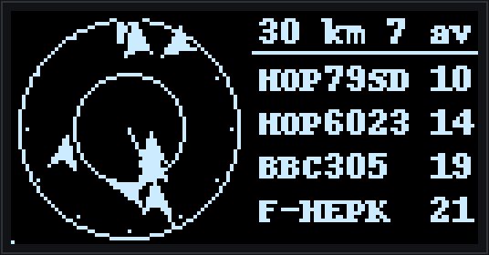
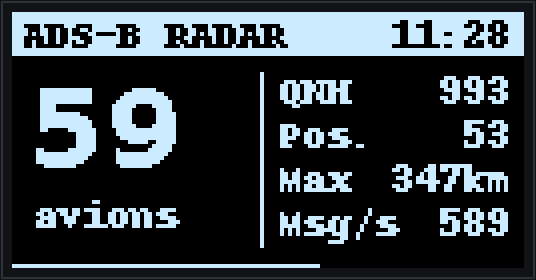
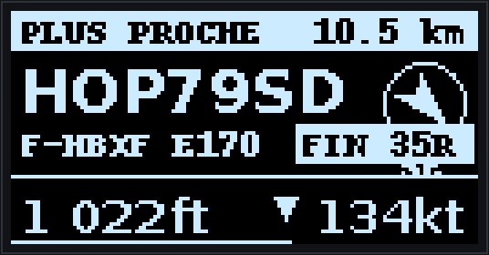
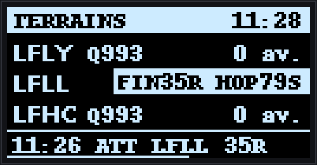
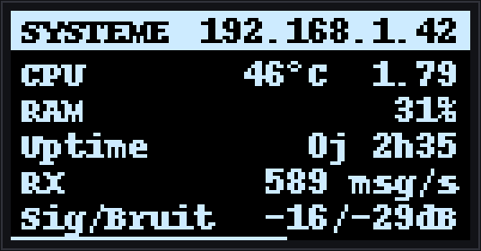
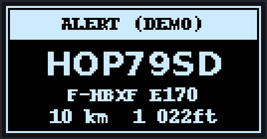

# PiSky-OLED By DRSEE

**A physical dashboard for your home ADS-B ground station, on a tiny 128×64 OLED.**

PiSky-OLED turns a cheap SSD1306 screen wired to your Raspberry Pi into a live companion for your
`readsb` / `tar1090` receiver: traffic count, the closest aircraft, an animated radar scope,
your local airfields and the health of your receiver — without opening a browser.

<p align="center">
  
</p>

---

## Pages

The screen rotates through five pages (durations are configurable). A thin bar at the bottom
shows the time left before the next page.

| | |
|:---:|:---:|
| <br>**Dashboard** — total aircraft, aircraft with position, local QNH, max range, messages/s | <br>**Closest aircraft** — callsign, registration & type, bearing arrow, altitude (QNH below the transition altitude, flight level above), climb/descent, ground speed, `FIN` badge on final approach |
| <br>**Radar** — round scope with sweep, aircraft drawn along their track, automatic range (15 / 30 / 60 km) and the four closest aircraft | <br>**Airfields** — QNH and traffic within 5 NM of each watched airfield, aircraft on final, last movement (landing, take-off, touch-and-go, circuit) |
| <br>**System** — CPU temperature & load, RAM, uptime, receiver messages/s, signal/noise (from `readsb`), IP address | <br>**Alert** — takes over the screen for 10 s on emergency squawks (7500 / 7600 / 7700) or a military aircraft inside your alert range |

> Screen labels are in French (e.g. *PLUS PROCHE* = closest, *TERRAINS* = airfields, *SYSTEME* = system).
> The images above are generated from live data with `preview.py --demo`.

---

## Features

* **Readable at a glance** — large vector digits for key values, crisp bitmap font for labels, inverted header bar.
* **Rich aircraft data** — registration, type, QNH-corrected altitude, final approach and airfield movements
  come from a companion ADS-B radar web app (HTTP API on port `5001`) when it runs on the same Pi.
  Without it, PiSky-OLED falls back to the raw `tar1090` `aircraft.json` feed.
* **Receiver health** — messages per second and signal/noise read from `/run/readsb/stats.json`.
* **Priority alerts** — emergency squawks and nearby military traffic interrupt the rotation.
* **OLED care** — the whole picture shifts by one pixel every 2 minutes to limit burn-in, and brightness
  drops automatically at night (22:00 – 07:00 by default).
* **Light on resources** — about 8 % of one CPU core on a Raspberry Pi 3B+.
* **Hardware-free previews** — `preview.py` renders every page to PNG (and the radar to an animated GIF).

---

## Prerequisites

### Hardware

1. **Raspberry Pi** (3, 4 or 5).
2. **ADS-B receiver** (RTL-SDR stick + antenna).
3. **SSD1306 OLED**, 128×64 pixels, connected via **I2C** (address `0x3C`).

### Software

* An ADS-B image running `readsb` + `tar1090` (e.g. [ADSBExchange](https://www.adsbexchange.com/how-to-feed/)).
* **Python 3.7+** with **Pillow** (DejaVu fonts are used when available: `fonts-dejavu-core`).
* **I2C enabled**: `sudo raspi-config` → Interface Options → I2C → Enable.

---

## Installation

```bash
git clone https://github.com/DRSEE/PiSky-OLED.git
cd PiSky-OLED
pip3 install -r requirements.txt
```

## Configuration

Everything is at the top of `main.py`:

```python
MY_LAT = 48.8566                 # station position (replaced by the radar app's settings when available)
MY_LON = 2.3522

PAGE_DURATIONS = {'dashboard': 6, 'closest': 8, 'radar': 15, 'airports': 8, 'system': 5}  # 0 = disabled
FPS = {'radar': 4}               # frames per second for animated pages (1 by default)
ALERT_SHOW_S = 10                # alert screen duration
NIGHT = (22, 7)                  # dimmed between 22:00 and 07:00
CONTRAST_DAY, CONTRAST_NIGHT = 255, 8
PIXEL_SHIFT_S = 120              # anti burn-in pixel shift period
```

---

## Usage

```bash
python3 main.py                        # run on the OLED
python3 preview.py                     # PNG previews of every page in ./preview
python3 preview.py docs/images --demo  # README images (IP masked) + animated radar GIF
```

### Run on boot (systemd)

```ini
# /etc/systemd/system/pisky.service
[Unit]
Description=PiSky OLED Service
After=network.target

[Service]
ExecStart=/usr/bin/python3 /home/pi/PiSky-OLED/main.py
WorkingDirectory=/home/pi/PiSky-OLED
Restart=always
User=pi

[Install]
WantedBy=multi-user.target
```

```bash
sudo systemctl daemon-reload
sudo systemctl enable --now pisky.service
```

---

## Project structure

```text
PiSky-OLED/
├── main.py              # Page rotation, alerts, night dimming, pixel shift
├── preview.py           # Renders pages to PNG / GIF without a screen
├── requirements.txt
├── docs/images/         # README screenshots
├── modules/
│   ├── datasource.py    # Radar API client, tar1090 fallback, system & receiver stats
│   ├── display.py       # Page rendering engine (128×64, 1-bit)
│   ├── adsb.py          # Legacy tar1090 reader (used by the web simulator)
│   ├── aircraft.py      # Legacy metadata lookup (used by the web simulator)
│   ├── geo_utils.py     # Distance / bearing helpers
│   └── system.py        # Legacy system helpers
└── simulation/          # Browser-based OLED simulator (Flask)
```

---

## Contributing

As an aviation enthusiast (**AvGeek**), feel free to fork this project, open issues or submit pull requests.
Every contribution to improve the tracking experience is welcome!

## License

This project is licensed under the **MIT License**.
